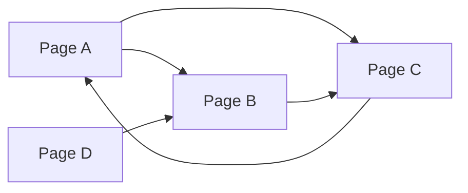
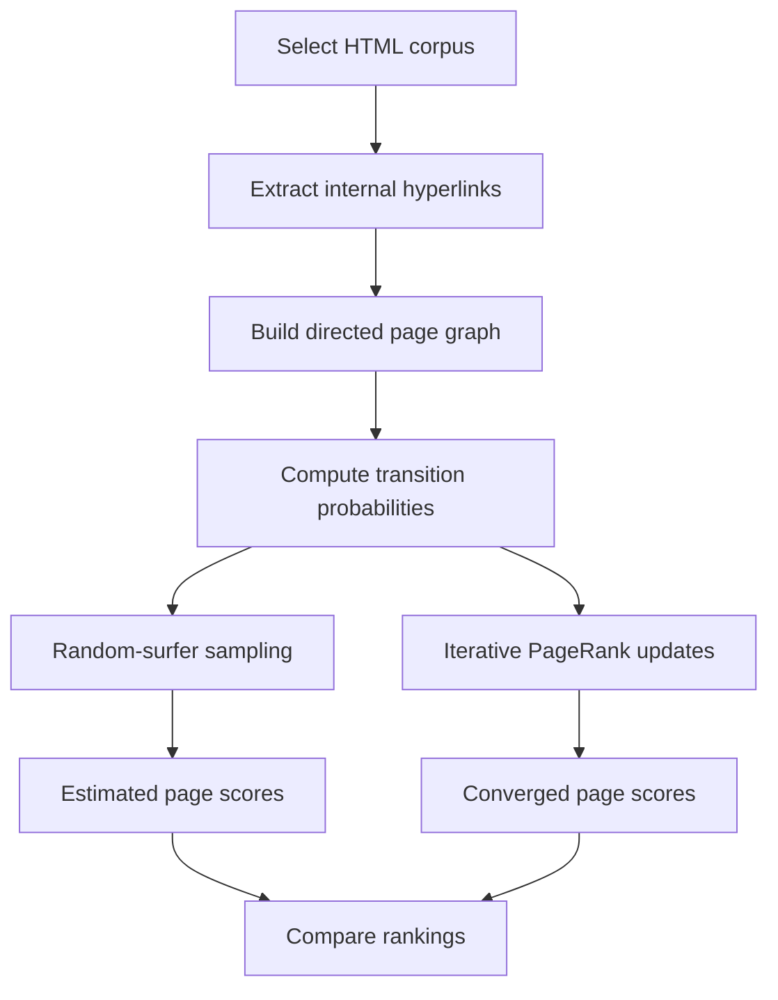

# PageRank — Probabilistic Ranking of Web Pages

**Harvard CS50's Introduction to Artificial Intelligence with Python | Project 2 — Uncertainty**

[](https://www.python.org/)
[](https://cs50.harvard.edu/ai/)
[](https://cs50.harvard.edu/ai/)

## Overview

PageRank is an algorithm for estimating the relative importance of pages in a network of hyperlinks. Instead of judging a page by its content alone, PageRank considers the structure of incoming and outgoing links: a page is considered influential when it receives links from other influential pages.

This project explores **two approaches to computing PageRank**:

1. **Random-surfer sampling** — simulate a user navigating between pages and estimate the proportion of visits to each page.
2. **Iterative probability updates** — repeatedly recompute each page's ranking until the values converge.

Both methods operate on local collections of HTML pages and use a configurable **damping factor**.

> **Academic context:** This is a course project from Harvard CS50's *Introduction to Artificial Intelligence with Python*. The starter materials and assignment concept are credited to CS50. This README documents the project and observed behavior; it does not reproduce its solution code.

## Core Concepts

- Directed graphs and hyperlink networks
- Probability distributions and random walks
- Markov-chain-style state transitions
- Damping and random teleportation
- Monte Carlo estimation
- Iterative convergence and stationary distributions
- Handling dangling pages (pages with no outgoing links)

## How PageRank Works

Represent each page as a node in a directed graph. A link from page A to page B forms a directed edge `A → B`.



### 1. The transition model

At each step, the hypothetical surfer either:

- follows a randomly selected outgoing link with probability **d**, or
- jumps to any page in the corpus with probability **1 − d**.

For a page with outgoing links, the probability of moving from page *i* to page *j* is:

$$
P(j \mid i) = \frac{1-d}{N} +
\begin{cases}
\frac{d}{L(i)}, & \text{if page } i \text{ links to } j \\
0, & \text{otherwise}
\end{cases}
$$

Where:

- **N** is the number of pages in the corpus.
- **d** is the damping factor, set to **0.85** in this implementation.
- **L(i)** is the number of outgoing links from page *i*.

**Dangling pages:** If a page has no outgoing links, it is treated as linking to **every** page in the corpus, each with equal probability.

### 2. Sampling-based estimation

The sampling method starts on a randomly chosen page, then uses the transition distribution to choose the next page repeatedly. A page's estimated PageRank is the fraction of samples spent on that page.

This implementation uses **10,000 samples** by default. Results fluctuate slightly across runs because the simulation is stochastic.

### 3. Iterative estimation

The iterative method begins by assigning all pages equal rank, then updates each page using contributions from other pages. For a page *j*:

$$
PR(j) = \frac{1-d}{N} + d \sum_{i \rightarrow j} \frac{PR(i)}{L(i)}
$$

Pages without outgoing links contribute their current rank equally to every page. The program stops when the **largest absolute rank change across all pages is at most 0.001**.

### Processing workflow



## Repository Structure

```text
pagerank/
├── pagerank.py          # Main script and PageRank calculations
├── corpus0/             # Four interconnected HTML pages
│   ├── 1.html
│   ├── 2.html
│   ├── 3.html
│   └── 4.html
├── corpus1/             # Seven pages about search and games
│   ├── bfs.html
│   ├── dfs.html
│   ├── games.html
│   ├── minesweeper.html
│   ├── minimax.html
│   ├── search.html
│   └── tictactoe.html
└── corpus2/             # Eight pages about AI and programming
    ├── ai.html
    ├── algorithms.html
    ├── c.html
    ├── inference.html
    ├── logic.html
    ├── programming.html
    ├── python.html
    └── recursion.html
```

The source archive also contained `__pycache__/`, which stores automatically generated Python bytecode and is **not required** to run the program.

### Code components

| Component | Purpose |
| --- | --- |
| `crawl(directory)` | Reads a corpus directory, extracts links, and keeps only links to pages within the corpus. |
| `transition_model(corpus, page, damping_factor)` | Computes a probability distribution over the next page to visit. |
| `sample_pagerank(corpus, damping_factor, n)` | Estimates page scores using a random walk and visit frequencies. |
| `iterate_pagerank(corpus, damping_factor)` | Repeatedly updates all ranks until the convergence threshold is reached. |
| `main()` | Loads a corpus, runs both approaches, and prints their scores. |

## Requirements

- **Python 3** (the project has been executed successfully using a Python 3 environment)
- No external Python packages required: the script imports only Python standard-library modules (`os`, `random`, `re`, and `sys`).

## Run Locally

Open a terminal in the project directory.

**Windows PowerShell**

```powershell
cd "X:\IO++\GitHub Upload\pagerank"
python pagerank.py corpus0
```

**macOS / Linux**

```bash
cd /path/to/pagerank
python3 pagerank.py corpus0
```

Run the other included datasets with:

```bash
python pagerank.py corpus1
python pagerank.py corpus2
```

The command accepts **one required argument**: the directory containing the HTML files. If it is missing, the program displays a usage message.

## Verified Execution Results

The supplied implementation was executed against all three included corpora. The following values were observed in one test run; sampling values may vary on subsequent runs.

### Corpus 0: four pages

| Page | Sampling (10,000 visits) | Iteration |
| --- | ---: | ---: |
| `1.html` | 0.2178 | 0.2198 |
| `2.html` | 0.4270 | 0.4294 |
| `3.html` | 0.2244 | 0.2198 |
| `4.html` | 0.1308 | 0.1311 |

In this corpus, **`2.html` ranks highest** under both approaches.

### Corpus 1: seven pages

| Page | Sampling | Iteration |
| --- | ---: | ---: |
| `bfs.html` | 0.1133 | 0.1152 |
| `dfs.html` | 0.0788 | 0.0809 |
| `games.html` | 0.2322 | 0.2277 |
| `minesweeper.html` | 0.1178 | 0.1180 |
| `minimax.html` | 0.1317 | 0.1312 |
| `search.html` | 0.2031 | 0.2090 |
| `tictactoe.html` | 0.1231 | 0.1180 |

**`games.html` and `search.html`** receive the two highest iterative scores.

### Corpus 2: eight pages

| Page | Sampling | Iteration |
| --- | ---: | ---: |
| `ai.html` | 0.1894 | 0.1889 |
| `algorithms.html` | 0.1058 | 0.1064 |
| `c.html` | 0.1244 | 0.1238 |
| `inference.html` | 0.1292 | 0.1289 |
| `logic.html` | 0.0270 | 0.0264 |
| `programming.html` | 0.2284 | 0.2301 |
| `python.html` | 0.1220 | 0.1238 |
| `recursion.html` | 0.0738 | 0.0717 |

**`programming.html`** has the highest PageRank in this corpus under both methods.

### Interpreting the results

The two approaches consistently identify the most important pages in these test corpora. Their numerical differences are expected: sampling approximates the distribution using a finite number of random transitions, while the iterative method applies updates until a predefined tolerance is reached.

The tables are **example execution results**, not guarantees of identical output for every run.

## Practical Applications

Concepts explored here are relevant to:

- Ranking and retrieval systems
- Graph-based recommendations
- Influence analysis in connected networks
- Modeling stochastic user navigation
- Understanding probability propagation over directed graphs

## Skills Demonstrated

`Python` · `Artificial Intelligence` · `Graph Algorithms` · `Probability` · `Markov Chains` · `Monte Carlo Sampling` · `Iterative Algorithms` · `Algorithm Analysis`

## Academic Attribution

This project was developed as part of **Harvard University's CS50's Introduction to Artificial Intelligence with Python**, taught by the CS50 team.

- **Course:** https://cs50.harvard.edu/ai/
- **Original assignment:** https://cs50.harvard.edu/ai/projects/2/pagerank/
- **Verified CS50AI certificate:** https://cs50.harvard.edu/certificates/4d1848b5-b7cc-4b37-8155-819e19e6054d

The course's academic-honesty rules should be reviewed before publicly distributing original assignment solutions. Documentation and demonstrations can be shared separately from solution source files.
